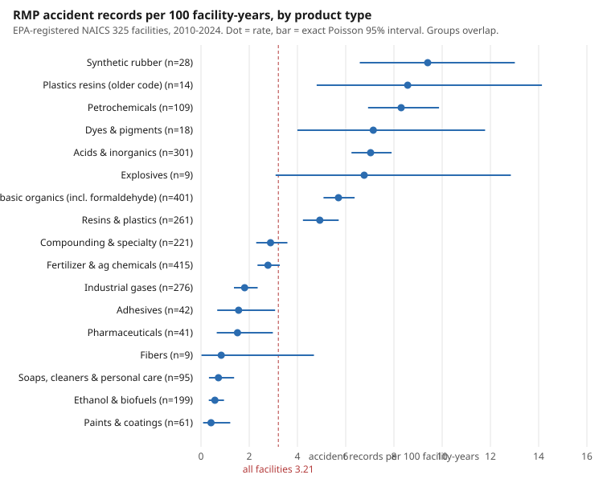

# What do EPA RMP accident histories say about chemical plant peer groups?

Backlog item B7. Everything here is computed by `scripts/build_accident_insights.py` from files already committed in this repository (`docs/data/plants.json`, `docs/data/releases.json`, `docs/data/meta.json`). Tables are in `outputs/accident_*.csv` and `outputs/accident_insights.json`. `tests/test_insights.py` reads the numbers in this file and fails if they disagree with those tables. Rebuild with `python3 scripts/build_accident_insights.py`.

## What was measured

The committed data does contain accident-level records: 2,611 RMP five-year accident-history records, each with a date, the chemicals involved, and yes/no flags for type, source, cause and changes afterwards. The unit here is the EPA-registered NAICS 325 facility (2,116 facilities with at least one observed year in 2010-2024). A facility-year is counted as observed under the rule in `docs/paper.md`: from five years before the facility's first RMP submission (no earlier than 2010) to 2024, or to its last submission year if it stopped filing. An "accident" is one RMP accident-history record dated inside that window. Overall that is 868 accident records over 27,058 facility-years, or 3.21 per 100 facility-years (exact Poisson 95% interval 3.00 to 3.43), and 384 of the 2,116 facilities (18.15%) had at least one.

Peer groups are the ones the explorer already uses: product type (from NAICS), chemical family (from chemicals held above the EPA threshold), and inventory band. Groups overlap, because a facility can hold several NAICS codes and chemical families.

## Three findings

**1. Accident-record rates differ about 14-fold between the highest and lowest product-type peer groups with 100 or more facilities.** Petrochemicals had 8.30 accident records per 100 facility-years (95% interval 6.93 to 9.87; 109 facilities). Ethanol and biofuels had 0.58 (0.32 to 0.95; 199 facilities). Acids and inorganics had 7.03 (6.24 to 7.90) and fertilizer and agricultural chemicals 2.78 (2.34 to 3.27). By chemical family, epoxy chain (9.73), strong acids (9.64) and sulfur compounds (9.27) were highest, and isocyanates (1.50) lowest. Chart: `docs/img/accident_rate_by_group.svg`. Table: `outputs/accident_by_subsector.csv`, `outputs/accident_by_family.csv`.

**2. Accidents are concentrated in a few facilities, and in the largest inventories.** 1,732 of 2,116 facilities (81.85%) had no accident record in their window. The 212 facilities in the top 10% by accident count account for 80.18% of all accident records, and the top 1% (22 facilities) for 28.57%. Facilities holding 5 million lb or more of regulated chemicals had 10.48 records per 100 facility-years (46.18% had at least one), against 0.92 (8.36%) for facilities under 100,000 lb. Tables: `outputs/accident_concentration.csv`, `outputs/accident_by_inventory.csv`. Inventory and product type overlap (large holders are concentrated in some product types), so these two findings are not independent.

**3. A peer group's accident ranking is stable across time, but its typical inventory explains only part of it.** Ranking the 13 product-type groups with at least 100 facility-years in each half, the rank correlation between their 2010-2016 rate and their 2017-2024 rate is 0.912 (Spearman). Across the 12 chemical families it is 0.769. Rates were lower in the later half in 11 of 13 product types, so level changed while order mostly did not. Across 17 product types, the rank correlation between a group's median inventory and its accident rate is 0.468, a moderate association from few groups. Table: `outputs/accident_split_half_subsector.csv`.

Chemicals named most often in accident records: chlorine (175 records at 78 facilities) and anhydrous ammonia (159 records at 90 facilities), then hydrofluoric acid (45) (`outputs/accident_top_chemicals.csv`). These are counts of records, not rates, because the committed holdings keep only each facility's ten largest chemicals.

## Limitations

* **Reporting, not risk.** Only accidents that meet EPA's five-year-history criteria (40 CFR 68.42) are on file. A group with a higher count may report more, hold more, or have more covered processes. Nothing here says why a rate is high or low, and none of it shows that a group is less safe.
* **Coverage window.** An accident is on file only if it fell in the five years before a submission. Facilities that stopped filing, or filed more than five years apart, may have unobserved accidents counted as accident-free years. The fall in later-period rates may partly reflect this and also reporting changes; the data cannot separate these.
* **Intervals are narrow.** Poisson intervals assume independent accidents. Accidents cluster (159 facilities had two or more, 90 had three or more), so the true uncertainty is wider than shown. Facility-level percentages use exact binomial intervals (columns `pct_lo`, `pct_hi`).
* **Small groups.** Several groups have under 30 facilities (synthetic rubber, dyes and pigments, explosives, fibers). Their intervals are wide and they are left out of the rank correlations unless they reach 100 facility-years in each half.
* **Overlap and confounding.** Groups overlap and are not adjusted for each other or for facility size. No regression is fitted.
* **Not done.** No severity-weighted analysis (injuries, evacuations, damage are in the data but not analysed here), no join of accidents to OSHA injury rates beyond what `docs/paper.md` already reports, no accident narratives, and no check against the current EPA RMP*Info database.

## How to use it

* **Regulator.** Use the group rate and the share of facilities with an accident as a context line when reading a facility's own history: in this data 18.15% of facilities have any record, so one record is common and three or more (90 facilities, 4.25%) is not. Because records are concentrated (finding 2), a list ordered by accident history and inventory puts the facilities behind most records first. This is a prioritisation aid, not a finding about any facility.
* **Plant EHS lead.** Compare your own accident count and facility-years with the closest group row (product type, chemical family, inventory band) and with its interval. If your count falls inside the interval, the data does not distinguish your plant from the group. Use the chemical and inventory rows to choose peers who hold similar material, and ask peers about practice, since this data cannot tell you what they do.

## Where each field comes from

| Field | Public source |
|---|---|
| Facility identity, NAICS code, submission years (`rmp_first`, `rmp_last`), active flag | EPA Risk Management Program database, FOIA copy via the [Data Liberation Project](https://www.data-liberation-project.org/datasets/epa-risk-management-program-database/); see [EPA RMP](https://www.epa.gov/rmp) |
| Chemicals and quantities held (inventory, chemical families) | Same RMP database, regulated-substance records; families are labels defined in `src/chempeers/taxonomy.py` |
| Accident date, chemicals involved | Same RMP database, five-year accident history (40 CFR 68.42) |
| Product type | Derived from the facility's NAICS code (US Census Bureau NAICS 325 subsectors), grouped in `src/chempeers/taxonomy.py` |
| Observation window | Derived from the submission years above, using the rule in `docs/paper.md` |

No OSHA data is used in this analysis. Method for the join and the rest of the data is in `DATASHEET.md` and `docs/paper.md`.
